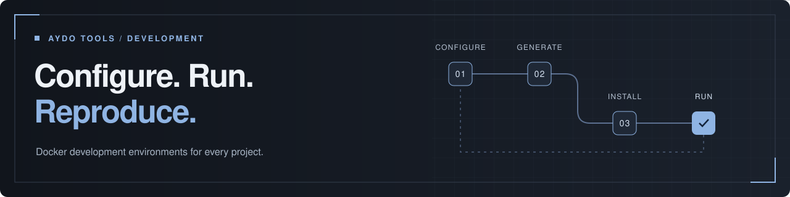
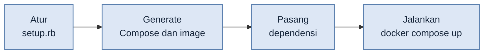

# AYDO Tools

**Lingkungan pengembangan Docker yang sama untuk setiap proyek.**

AYDO Tools mengembangkan tool pendukung pengembangan aplikasi. Fokus utamanya adalah template Docker Compose yang menyiapkan lingkungan pengembangan lengkap untuk proyek Laravel baru maupun yang sudah ada, termasuk proyek berbasis Winter CMS dan Filament.

[Pendekatan](#pendekatan) · [Alur setup](#alur-setup) · [Cakupan](#cakupan) · [Prinsip](#prinsip)

## Pendekatan

Template di-clone sebagai folder proyek, lalu aplikasi ditempatkan di `webroot/`. Pengaturan proyek, seperti nama, subnet, versi PHP, dan database, ditulis di bagian atas `setup.rb`. Generator kemudian membuat file Compose, image, dan konfigurasi yang dibutuhkan.

Kode aplikasi dan konfigurasi lingkungan berada di repository yang terpisah. Template yang sama dapat dipakai berulang tanpa mengubah aplikasi.

## Alur setup

Setup berhenti pada perintah pertama yang gagal. Migrasi database tidak dijalankan kecuali diaktifkan secara eksplisit.

## Cakupan

| Area | Isi |
| :--- | :--- |
| **Runtime** | PHP-FPM di belakang Nginx, dengan versi PHP yang dapat dipilih per proyek. |
| **Database** | MariaDB, MySQL, atau PostgreSQL, ditambah Redis. |
| **Frontend** | Server pengembangan Vite di dalam container aplikasi. |
| **Layanan pendukung** | Mailpit, phpMyAdmin, queue worker, dan scheduler sesuai kebutuhan proyek. |
| **Jaringan** | Subnet dan hostname `.test` tersendiri untuk setiap proyek. |

## Prinsip

- **Dapat dibuat ulang.** Lingkungan proyek dapat disiapkan kembali dari template dan repository aplikasi.
- **Aman secara default.** Tindakan yang mengubah atau menghapus data tidak berjalan tanpa diaktifkan.
- **Versi yang konsisten.** PHP, Composer, dan Node dijalankan di container, bukan di host.
- **Satu template per stack.** Template diperbaiki di tempat, bukan dibuat ulang sebagai repository baru.

---

AYDO Tools · Configure. Run. Reproduce.
